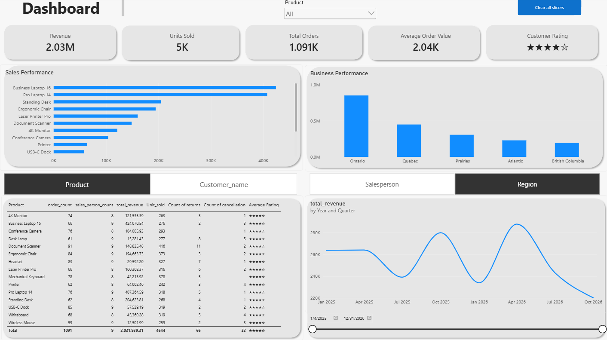
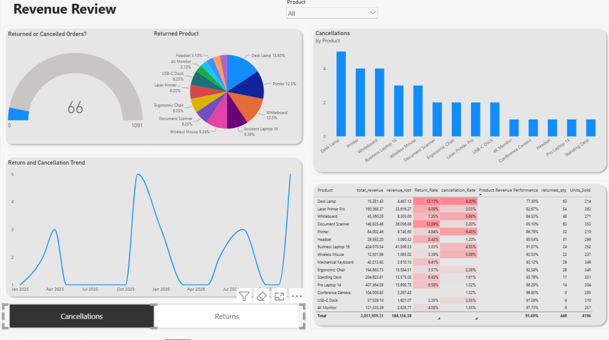

# Northstar Sales Performance Analysis

## Project Overview

This project analyzes Northstar's sales performance using transactional sales records from 2025–2026. The objective was to transform raw sales data into actionable business insights by evaluating revenue performance, customer behavior, regional sales, product performance, cancellations, and returns.

The project demonstrates an end-to-end data analytics workflow, from data preparation and SQL analysis to interactive Power BI visualization and business reporting.

## Business Objectives

The analysis was designed to answer the following business questions:

- What is the overall net revenue generated during the analysis period?
- Which products contribute the most and least to total revenue?
- Which regions generate the highest and lowest revenue?
- How do sales channels perform?
- Which products have high cancellation and return rates?
- Which products require further investigation?
- What business actions could help improve sales performance?

## Tools and Technologies

| Tool | Purpose |
|---|---|
| Microsoft Excel | Data preparation and initial exploration |
| SQL | Data querying, aggregation, analysis, and KPI calculations |
| Microsoft Power BI | Interactive dashboards and data visualization |
| PDF Reporting | Business findings and recommendations |

## Project Workflow

### 1. Data Preparation

The raw transaction data was prepared for analysis and organized for querying and reporting.

Data preparation included reviewing the available fields and ensuring that the dataset could support the required revenue, product, customer, and regional analysis.

### 2. SQL Analysis

SQL was used to analyze transactional data and calculate key performance indicators.

The analysis included:

- Total net revenue
- Revenue by product
- Revenue by region
- Revenue by sales channel
- Customer revenue analysis
- Running revenue totals
- Order performance
- Cancellation rates
- Return rates
- Product performance rates

SQL aggregations, joins, subqueries, and window functions were used to support the analysis.

### 3. Power BI Dashboard

Power BI was used to create an interactive dashboard to present the key findings.

The dashboard includes performance metrics and visualizations relating to:

- Total revenue
- Order count
- Average order value
- Units sold
- Customer ratings
- Product performance
- Regional revenue

The dashboard provides a visual overview of sales performance and supports further exploration of the findings.

### 4. Business Reporting

The final report summarizes the major findings, identifies underperforming products, and presents recommendations based on the analysis.

The report also documents important assumptions and limitations to ensure that the recommendations are interpreted appropriately.

## Key Findings

### 1. Revenue Performance

The analysis estimated total net revenue of approximately **$2,031,939** after accounting for cancelled and returned orders.

The highest-revenue products were:

| Product | Net Revenue |
|---|---:|
| Business Laptop 16 | $424,070.54 |
| Pro Laptop 14 | $407,364.59 |
| Standing Desk | $204,623.81 |
| Ergonomic Chair | $194,663.73 |

These products represent important contributors to overall revenue.

### 2. Regional Performance

Ontario generated the highest revenue, while British Columbia and the Atlantic region recorded the lowest regional revenues.

| Region | Net Revenue |
|---|---:|
| Ontario | $851,247.68 |
| Quebec | $449,261.82 |
| Prairies | $306,511.93 |
| Atlantic | $229,391.61 |
| British Columbia | $195,526.67 |

These findings highlight potential opportunities for targeted marketing and regional sales improvement.

### 3. Sales Channel Performance

In-store sales generated the lowest net revenue, at approximately **$36,956**.

This suggests an opportunity to investigate ways to improve in-store sales through targeted promotions and advertising.

### 4. Product Performance

Three products recorded performance rates below 90%.

| Product | Performance Rate | Revenue | Cancellation Rate | Return Rate |
|---|---:|---:|---:|---:|
| Desk Lamp | 77.30% | $15,281 | 8.20% | 13.11% |
| Laser Printer Pro | 82.67% | $166,368 | 3.03% | 9.09% |
| Whiteboard | 84.53% | $45,360 | 5.88% | 7.35% |

## Business Recommendations

### 1. Investigate Desk Lamp Performance

The Desk Lamp recorded the lowest performance rate and revenue, alongside the highest return rate.

Recommended areas of investigation include:

- Product quality
- Customer feedback
- Pricing
- Supplier reliability

### 2. Review Whiteboard Performance

The Whiteboard recorded relatively low revenue and a performance rate below 90%.

Potential areas for improvement include pricing, product descriptions, and market demand.

### 3. Investigate Laser Printer Pro Returns

Although the Laser Printer Pro recorded a low performance rate and elevated return rate, it also contributed substantial revenue.

Further investigation into the causes of returns and cancellations is recommended before making any product-retention decisions.

### 4. Improve Regional and In-store Sales

Targeted marketing and promotional strategies could help improve sales in lower-performing regions and increase in-store revenue.

## Limitations and Assumptions

- Product purchase cost data was not available. Therefore, the analysis focuses on revenue and order performance rather than profit margins or profitability.
- Blank salesperson fields were assumed to represent in-store purchases not attributed to a specific salesperson. This assumption requires verification.
- Product recommendations are based on revenue, cancellation, return, and performance rates. They do not independently establish product profitability.

## Project Deliverables

The repository contains the project files used to conduct and present the analysis:

- SQL analysis scripts
- Power BI dashboard file
- Business analysis report
- Supporting project data, where included

## Skills Demonstrated

This project demonstrates practical skills in:

- Data cleaning and preparation
- SQL querying and analytical functions
- KPI development
- Revenue and product performance analysis
- Data visualization
- Dashboard development
- Business insight generation
- Analytical reporting
- Translating data findings into business recommendations

## Conclusion

The Northstar Sales Performance Analysis project demonstrates how transactional sales data can be transformed into meaningful business insights.

By combining SQL analysis, Power BI visualization, and business reporting, the project identifies revenue drivers, regional opportunities, and products requiring further investigation.

The findings provide a foundation for informed business decisions and demonstrate an end-to-end approach to data analytics.

---

## Author

**Wisdom Agboighale**

**Project:** Northstar Sales Performance Analysis  
**Project Type:** Sales Data Analytics  
**Analysis Period:** 2025–2026  
**Tools:** Microsoft Excel, SQL, Microsoft Power BI